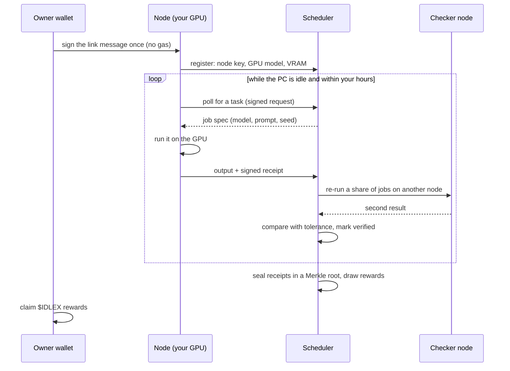

# Idlex node

The Idlex node runs AI jobs on an NVIDIA GPU during the hours you don't use your PC. Each result is signed and
reported to the scheduler, and other nodes re-run a share of the jobs to check them. Verified work earns
$IDLEX.

This repository contains:

- the node agent, the program a GPU owner runs;
- its AI runners and output checks;
- the installers for Windows and Linux;
- a local prototype of the whole network (scheduler, nodes and a builder) that runs on one PC.

For the guided setup, go to [idlex.network/run-a-node](https://idlex.network/run-a-node).

## How a node works



### 1. Two keys, kept apart

- The **node key** is created on your machine (`~/.idlex-node/key.json`). It only signs API requests and job
  receipts.
- The **owner wallet** holds your $IDLEX and receives the rewards. You link it to the node once by signing a
  message, with no gas and no transaction. The node never sees the wallet's private key.

Each wallet can run one GPU. The scheduler refuses a second GPU for the same owner, and refuses a GPU (by its
UUID) that is already linked to another owner.

### 2. Only when the GPU is idle

The agent ([src/agent.ts](src/agent.ts)) checks before every task and pauses when:

- the local time is outside the hours you set (`--hours 1-8,22-24`);
- another program uses more than 500 MB of VRAM (a game, a render, a video editor);
- the GPU is at 83 °C or hotter.

### 3. The jobs

| Type | Model | Runtime |
| --- | --- | --- |
| Image | Stable Diffusion 1.5 | PyTorch CUDA ([python/image_worker.py](python/image_worker.py)) |
| Text | Qwen2.5 3B / 7B (GGUF) | llama.cpp `llama-server`, greedy decoding |

Every job comes with its seed and settings, so two honest GPUs return the same output or one that is very
close.

### 4. Receipts and checks

Every request a node sends is signed: an EIP-191 signature over the method, path, timestamp and body hash.
For each result, the node also signs an EIP-712 receipt with the job id, the node, the output hash, the GPU
time and the epoch.

The scheduler first checks that the output matches the signed hash. Then it:

- re-runs a node's first 5 jobs on a different node (probation), and about 10% of its jobs after that;
- compares the two outputs with a tolerance ([src/verify.ts](src/verify.ts)):
  - images: a 64-bit perceptual hash, at most 12 bits apart;
  - text: an edit-distance similarity of at least 0.9.
- calls a third node when the two disagree. The node whose result differs from the other two loses part of its
  stake. If no two results agree, the job is marked disputed and the builder gets a refund.

The receipt also records the reported GPU time, but only for information. Rewards don't depend on it, because a
node could inflate it.

### 5. Rewards

The verified receipts of each round are sealed into one Merkle root ([src/merkle.ts](src/merkle.ts)). Every
verified job then draws a reward of 100–200 $IDLEX, computed from that root and its job id, so anyone can
recompute each draw. The network pays out at most 10,000 $IDLEX per hour, and owners can claim at any time.

## Run a node

You need:

- an NVIDIA RTX 30 series GPU or newer, with a recent NVIDIA driver;
- Node.js 22.18 or newer;
- one of these systems:
  - **Windows 10/11**, with Python 3.10–3.12, and about 12 GB of free disk;
  - **Ubuntu 24.04 or newer** (glibc 2.38+), with Python 3.10–3.13 (`sudo apt install python3-venv libgomp1`),
    and about 20 GB of free disk.

The installers put everything in the agent's folder:

- npm packages;
- a Python environment with PyTorch and diffusers, for image jobs;
- llama.cpp's CUDA build and the Qwen2.5-3B model, for text jobs.

Every download is pinned to a version and checked by SHA-256. Both platforms get the same versions and models,
because nodes re-run each other's jobs.

**Windows**

```bash
powershell -ExecutionPolicy Bypass -File install.ps1
```

**Linux**

```bash
bash install.sh
```

Then link your wallet and start the node:

```bash
node src/agent.ts init                                  # creates the node key, if the installer didn't
node src/agent.ts link-message --owner 0xYOUR_WALLET    # sign this message in your wallet
node src/agent.ts start --owner 0xYOUR_WALLET --owner-sig 0xSIGNATURE --hours 0-24
```

On Linux, run the agent in tmux or screen, or as a service. It stops cleanly on SIGTERM.

**Set your price (open market, beta).** Each node sets an ask per model, as a multiple of the listed price, from
0.5 to 2. Builders pick the cheapest or the fastest offer, so a lower ask wins more jobs. Every verified job earns
the same 100–200 $IDLEX whatever its price. Without `--ask` you ask 1×.

```bash
node src/agent.ts start --owner 0xYOUR_WALLET --owner-sig 0xSIGNATURE --ask 0.9
node src/agent.ts start --owner 0xYOUR_WALLET --owner-sig 0xSIGNATURE --ask sd15=0.8,qwen2.5-3b=1.1
```

Live asks and recent priced jobs: https://www.idlex.network/market

**Same output on Windows and Linux.** On the same NVIDIA GPU, the fixed text job in
[src/xplat-check.ts](src/xplat-check.ts) gives byte-identical output with the Windows and Linux builds of
llama.cpp, and each build repeats exactly. Image jobs have not been compared across the two systems yet.

## Try the whole network on one PC

The local prototype runs a scheduler, three nodes (one of them cheats) and a builder on one machine. It uses a
simulated ledger, so there are no real tokens involved.

Its job renders a fractal tile with a WebGPU compute shader, through headless Chrome. The kernel uses
integer-only math, so every honest GPU returns the exact same pixels, and a spot-check is a simple hash
comparison. A discrete NVIDIA GPU and an integrated AMD GPU produce bit-identical output.

It needs Node.js 22.18+ and Chrome.

```bash
npm install
npm test            # 24 checks: GPU vs CPU reference, Merkle proofs, every failure path, epoch accounting
npm run gpu-check   # renders one tile on each GPU and compares hashes
npm run demo        # scheduler + 3 nodes + a builder, dashboard at http://localhost:8787
```

Or run the pieces separately, each in its own terminal:

```bash
npm run scheduler                                   # dashboard at http://localhost:8787
npm run node -- start --stake 15000                 # discrete GPU
npm run node -- start --gpu low --stake 15000 --key-file ./data/key-b.json   # integrated GPU
npm run builder -- submit --count 6
```

You can tune it with these settings: `PORT`, `EPOCH_SECONDS`, `SPOT_RATE`, `PROBATION_JOBS`, `SLASH_BPS`,
`IDLEX_PRICE_USDG` and `TASK_TIMEOUT`. `DEV` turns on the dev faucets (on by default).

### Demo result

12 jobs at 1024×768 and 2,000 iterations:

| Node | GPU | Stake after | Jobs / checks | $IDLEX reward |
| --- | --- | --- | --- | --- |
| A | NVIDIA, discrete (honest) | 15,000 | 4 / 8 | 54,794 |
| B | AMD, integrated (honest) | 15,000 | 4 / 8 | 54,794 |
| C | NVIDIA, discrete (cheats) | 46 | 0 / 0 | 0 |

All 12 jobs were verified. C was caught on every job it touched: it lost 11,953 $IDLEX of stake and fell below
the 100 USD minimum.

### What `npm test` checks

- **GPU output:** it equals a CPU reference of the kernel, on both GPUs, including a deep zoom, extreme
  constants and odd sizes.
- **Requests:** a node with no stake, or 99.99 USD of stake, is refused. The scheduler rejects a body changed
  after signing, a signature for another address, and a 2-minute-old request.
- **Jobs:**
  - it refuses a job with no credits, bad params or a duplicate nonce;
  - a node can't answer another node's task, or answer twice;
  - a receipt signed by another key is refused;
  - a node that goes quiet loses the task to another node;
  - pixels that don't match the signed hash get the node slashed;
  - three different results end in a dispute, with a refund and no slash.
- **Epoch close:**
  - only verified jobs are charged, and the disputed job is refunded;
  - every receipt has a valid Merkle proof;
  - the reward budget is split in full, and only to eligible nodes;
  - an inflated GPU time earns nothing extra.

## Files

| Path | What it is |
| --- | --- |
| [src/agent.ts](src/agent.ts) | The node agent: register, idle checks, poll, run, report |
| [src/ai-runners.ts](src/ai-runners.ts) | Image (Stable Diffusion) and text (llama.cpp) runners |
| [src/verify.ts](src/verify.ts) | Tolerance checks for image and text outputs |
| [src/protocol.ts](src/protocol.ts) | Job specs, prices, receipts and request signing |
| [src/merkle.ts](src/merkle.ts) | Merkle root and proofs over receipts |
| [src/net-builder.ts](src/net-builder.ts) | Submit image and text jobs to a scheduler |
| [src/xplat-check.ts](src/xplat-check.ts) | Compares a fixed job's output across machines |
| [src/scheduler.ts](src/scheduler.ts), [src/ledger.ts](src/ledger.ts) | Local prototype scheduler and simulated ledger |
| [src/node-client.ts](src/node-client.ts), [src/gpu-runner.ts](src/gpu-runner.ts), [src/kernel.ts](src/kernel.ts) | Prototype node and its WebGPU kernel |
| [install.ps1](install.ps1), [install.sh](install.sh) | Installers for Windows and Linux |

## Known limits

- Majority voting can be fooled if one person runs two nodes that agree with each other. The planned fixes are
  random assignment, stake-weighted checks and known-answer jobs.
- While the network is small, a spot-check can wait an hour for a second node. If none takes it, the job is
  settled on its own result.

## License

[MIT](LICENSE)
